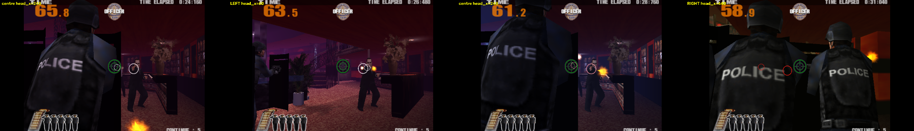

# Does the camera tracker actually drive gameplay?

**Yes.** Verified 2026-09-13 on the PAL disc (SLES-50285, CRC 08A1C938) under
PCSX2 2.6.3.

This was the project's blocking unknown. Every measurement anyone had taken —
here or anywhere on the public web — was on the SENSOR ADJUSTMENT screen.
Nothing confirmed the tracker did anything during an actual stage, and the whole
rig is pointless if it does not.

## What was done

Reached the first stage (hotel lobby), then drove the head position **directly
in EE memory** via the hook in `re/ram/hook.py` — the camera image was ignored
entirely — and captured the view at three commanded positions.

| commanded | what the screen showed |
|---|---|
| `head_x = 248` (centre) | player tucked behind an officer's back; only a narrow gap of the room visible |
| `head_x = 60` (left) | **cover gone** — wide open view of the room, enemy fully exposed |
| `head_x = 248` (centre) | back behind cover, composition identical to the first centre shot |
| `head_x = 440` (right) | leaned the other way into a different position, two officers filling the view |



The two centre frames match each other while the left and right frames are
radically different, so this is a real, repeatable response to the commanded
position and not scene animation.

## What this establishes

1. **The tracker drives the in-game camera and cover state during a stage**, not
   merely the calibration screen.
2. **The response is graduated**, matching the one hands-on account of the PS2
   port: leaning changes how much of the room is exposed, rather than flipping a
   binary in-cover flag.
3. **The camera image is not needed.** Gameplay responded to memory writes while
   the synthetic camera blob sat in an unrelated part of the frame.

## How it was driven

`re/ram/hook.py` NOPs two branch guards so the game reloads its head position
from memory every frame instead of computing it from the camera:

```
0x001BC808  bnez $s0, 0x1bc824   ->  nop
0x001BC810  bnez $s1, 0x1bc824   ->  nop

0x0029F0F8  head X   (int32)
0x0029F0F4  head Y   (int32)
```

Neutral — the value pair that puts the game's own marker inside its calibration
ring, which then turns green — is `(248, 71)`. Full detail and the measured
linearity in `re/RE_FINDINGS.md`.

## Not yet established

- How far a lean must travel for the game to treat the player as **fully out of
  cover** versus peeking. The three sampled positions were far apart; the
  in-between behaviour is unmapped.
- Whether `head_y` (duck) engages a distinct cover state during a stage. Only
  the horizontal axis was exercised here.
- Whether enemy fire actually misses while leaned — i.e. that the mechanic is
  defensively meaningful and not only a camera shift.

Those are the next measurements, and they no longer need the camera path at all.
